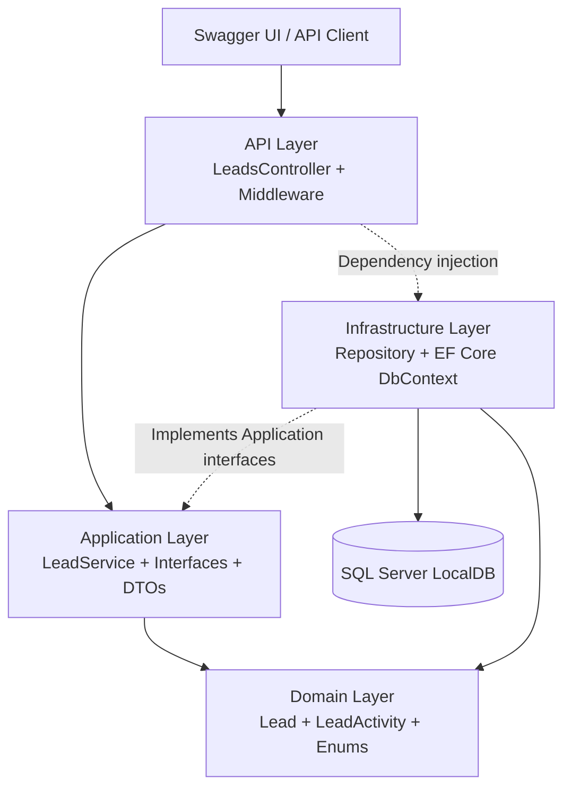
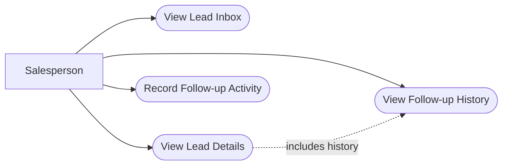
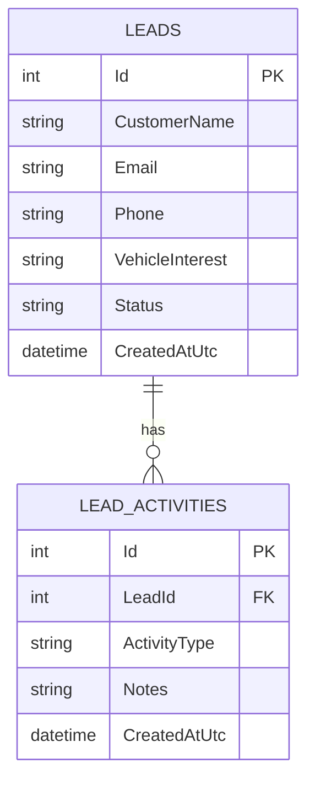
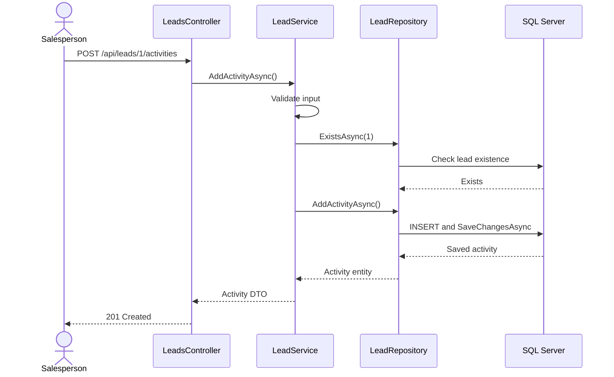

# System Design Document
## Sales Lead Management Tool — Keyloop Technical Assessment

**Scenario:** C — Sales Lead Management Tool  
**Domain:** Demand  
**Solution:** KeyLoopSalesman  
**Architecture:** Clean Architecture (modular monolith)  
**Technology:** ASP.NET Core 10, C#, EF Core 10, SQL Server LocalDB  
**Document status:** Implementation-aligned design; final verification pending  

---

## 1. Executive Summary

The Sales Lead Management Tool helps automotive dealership salespeople manage enquiries received from a dealership website.

The system provides a centralized lead inbox, complete customer enquiry details, chronological follow-up activity history and persistent activity logging.

The implementation focuses on the backend service layer, as permitted by the assessment. Swagger UI acts as an interactive API client rather than a full salesperson-facing frontend.

The solution adopts a lightweight Clean Architecture to isolate business rules from HTTP handling and database implementation.

The design prioritizes correctness, traceability, maintainability and predictable database persistence over unnecessary infrastructure complexity.

## 2. Problem Statement

Dealership enquiries can be difficult to track if salespeople maintain follow-up information manually or across disconnected systems.

The system addresses three primary needs:

1. **Lead Inbox:** Retrieve the list of customer enquiries.
2. **Lead Details:** Retrieve a selected lead and its chronological follow-up history.
3. **Activity Logging:** Record follow-up actions and persist them for later retrieval.

The system must be simple enough for a small dealership but designed to evolve as lead volumes and dealership users increase.

## 3. Scope and Assumptions

### 3.1 In Scope

- RESTful backend API
- Persistent relational database
- Lead inbox retrieval
- Individual lead details
- Chronological follow-up history
- New follow-up activity creation
- Input validation and HTTP error handling
- Swagger API exploration
- Automated business-logic tests
- Structured diagnostic logging

### 3.2 Outside the Implemented Scope

- Complete React or Angular frontend
- Real dealership website integration
- Authentication and role-based authorization
- SMS or email delivery
- Lead assignment workflows
- Production cloud deployment
- Distributed caching and messaging infrastructure

### 3.3 Assumptions

- Incoming website leads are simulated through development seed data.
- Each lead represents one customer enquiry about a vehicle.
- One lead may have zero or more follow-up activities.
- Supported follow-up types are Call, Email, Meeting and Other.
- Activities are recorded using UTC timestamps.
- Leads are retrieved without pagination in the initial implementation.
- The initial database is Microsoft SQL Server LocalDB.
- Real multi-dealership access control is a future requirement, not an implemented feature.

These assumptions are design decisions and are not additional Keyloop-mandated requirements.

## 4. Functional Requirements

| ID | Requirement | Proposed solution |
|---|---|---|
| FR-01 | Display incoming leads | GET /api/leads |
| FR-02 | Display full lead details | GET /api/leads/{id} |
| FR-03 | Display chronological history | Lead details include activities ordered by timestamp and ID |
| FR-04 | Retrieve follow-up activities | GET /api/leads/{id}/activities |
| FR-05 | Record new follow-up | POST /api/leads/{id}/activities |
| FR-06 | Persist activities | EF Core SaveChangesAsync with SQL Server |
| FR-07 | Handle unknown leads | 404 Not Found |
| FR-08 | Reject invalid activity data | 400 Bad Request |

## 5. Non-Functional Requirements

| Quality attribute | Design strategy |
|---|---|
| Maintainability | Independent Domain, Application, Infrastructure and API projects |
| Performance | Async EF Core queries, AsNoTracking and database indexes |
| Reliability | SQL constraints, validation, exception handling and persistence tests |
| Scalability | Stateless API design; future pagination and horizontal scaling |
| Security | Input validation and HTTPS; production authentication still required |
| Observability | ILogger, request duration, status codes and correlation identifiers |
| Testability | Repository interfaces, unit tests and database integration tests |

No numerical latency, throughput or availability SLA was supplied in the assessment. Performance targets should be established through measurement rather than presented as verified guarantees.

## 6. Architecture Overview

The system follows Clean Architecture, packaged as a modular monolith.

### 6.1 Component Diagram



### 6.2 Dependency Rule

Dependencies point toward the core application and domain abstractions.

- Domain has no dependencies on ASP.NET Core or EF Core.
- Application depends on Domain and defines repository interfaces.
- Infrastructure depends on Application and Domain and implements database access.
- API depends on Application and Infrastructure to configure and expose the solution.
- Tests reference the relevant projects for verification.

The runtime request flow moves from API to Application to Infrastructure, but dependency direction is controlled through interfaces.

## 7. Component Responsibilities

### Domain Layer

Project: KeyLoopSalesman.Domain

Contains Lead, LeadActivity, LeadStatus and LeadActivityType.

Represents the application's core business concepts without requiring HTTP or persistence libraries.

### Application Layer

Project: KeyLoopSalesman.Application

Contains request and response DTOs, ILeadService, ILeadRepository and LeadService.

Responsible for retrieving enquiries, checking lead existence, validating follow-up details and mapping domain entities to API response models.

### Infrastructure Layer

Project: KeyLoopSalesman.Infrastructure

Contains LeadRepository, LeadManagementDbContext, database configuration, EF Core migrations and development seed data.

Responsible for translating application repository operations into SQL Server queries and persisting database changes.

### API Layer

Project: KeyLoopSalesman.Api

Contains LeadsController, dependency injection registrations, middleware, configuration and Swagger.

Responsible for HTTP request handling, response status codes, API documentation and application startup.

### Tests

Project: KeyLoopSalesman.Tests

Contains isolated business-logic tests and a proposed integration test using a separate SQL Server test database.

## 8. UML Use Case Diagram



The salesperson interacts with the backend through an API client in the assessment demonstration. A graphical lead inbox is an intended production user experience, not part of the backend-only deliverable.

## 9. Domain Model and Database Design

### 9.1 Entity Relationship Diagram



### 9.2 Database Constraints

- Primary keys uniquely identify leads and activities.
- LeadActivities.LeadId references Leads.Id.
- Activity notes are limited to 1,000 characters.
- ActivityType is limited to defined application values.
- CreatedAtUtc records the time of creation.
- A composite index on LeadId, CreatedAtUtc and Id supports chronological activity queries.
- Restrict deletion prevents automatic removal of historical activities when a lead is deleted.

### 9.3 Database Technology

SQL Server LocalDB is used for development because it provides real SQL Server persistence, relational constraints and straightforward Visual Studio integration.

EF Core Code First migrations create and maintain the database schema.

For production, the database could move to managed SQL Server or Azure SQL without changing core application business logic. Provider configuration and operational differences would still require testing.

## 10. REST API Contract

### 10.1 Lead Inbox

GET /api/leads

Successful response: 200 OK

Returns customer enquiries, ordered from newest to oldest.

### 10.2 Lead Details

GET /api/leads/{id}

Successful response: 200 OK  
Unknown lead: 404 Not Found

Returns customer information together with a chronological activities collection.

### 10.3 Activity History

GET /api/leads/{id}/activities

Successful response: 200 OK  
Unknown lead: 404 Not Found

Activities are ordered ascending by CreatedAtUtc and then Id.

### 10.4 Create Follow-up Activity

POST /api/leads/{id}/activities

Example request:

```json
{
  "activityType": "Call",
  "notes": "Customer requested a test drive."
}
```

Expected responses:

- 201 Created — activity saved
- 400 Bad Request — invalid request
- 404 Not Found — referenced lead does not exist
- 500 Internal Server Error — unexpected server failure

### 10.5 Error Contract

Validation and unexpected failures are represented using HTTP problem detail responses.

Unexpected internal exceptions must not expose stack traces or SQL connection details to clients.

## 11. Request Data Flow

### 11.1 Record Follow-up Activity — Sequence Diagram



### 11.2 Retrieve Lead Details

1. Client requests GET /api/leads/{id}.
2. Controller calls LeadService.
3. LeadService requests the lead and its activities from the repository.
4. Repository executes EF Core read queries.
5. Results are mapped into LeadDetailsDto.
6. Controller returns 200 OK or 404 Not Found.

Read operations use AsNoTracking where appropriate.

## 12. Scalability Strategy

The initial application is a single-process backend using SQL Server LocalDB.

### 12.1 Horizontal Scaling

A future production deployment could run multiple stateless ASP.NET Core API instances behind a load balancer.

Database state would be stored centrally rather than in server memory.

### 12.2 Lead Inbox Pagination

The initial GET /api/leads returns all records.

A future paginated endpoint could support page number, page size, status, dealership and search filters.

Pagination prevents large result sets from increasing network usage and memory consumption as lead volumes grow.

### 12.3 Database Optimization

- Retain indexes supporting common lookups.
- Add dealership-aware indexes when multi-tenancy is introduced.
- Use selective projections for large inbox queries.
- Analyze SQL execution plans before making indexing changes.
- Monitor connection pool usage and query duration.

### 12.4 Caching

Redis is not implemented or currently required.

Lead activity histories change whenever a salesperson records a follow-up, so caching must address stale results and invalidation. Database and application optimizations should be measured before introducing a cache.

### 12.5 Why Not Microservices?

The application has a small, cohesive domain and limited operational complexity.

Separating lead inbox and activity logging into different deployable services would introduce network calls, deployment complexity and distributed failure handling without a demonstrated business need.

A modular monolith is a proportionate starting architecture.

## 13. Rate Limiting

Rate limiting is not explicitly mandated by the scenario, but would be useful in production to protect endpoints against request floods and excessive consumption.

A future policy could apply:

- Per-user limits to lead queries
- Stricter limits to follow-up creation
- HTTP 429 Too Many Requests when limits are exceeded
- Retry-After information where applicable

ASP.NET Core provides built-in rate-limiting middleware.

For a horizontally scaled environment, instance-local counters would not enforce a global limit. A gateway or shared enforcement strategy would be required.

**Current implementation status:** Production rate limiting is a proposed enhancement, not a verified implemented feature.

## 14. Security Design

### Current Controls

- Request validation
- Bounded string lengths
- Database constraints
- HTTPS development configuration
- Error responses that do not deliberately reveal internal exceptions

### Production Enhancements

- Authentication through OpenID Connect or JWT bearer tokens
- Role-based and dealership-scoped authorization
- Access controls ensuring one dealership cannot read another's leads
- Least-privilege SQL credentials
- Secrets stored in managed configuration or secret storage
- Audit logging for sensitive operations
- Sensitive customer data excluded from application diagnostic logs
- Rate limiting and abuse protection

Customer names, phone numbers and emails are personally identifiable information and require appropriate access controls in a production environment.

## 15. Reliability and Failure Handling

### Invalid Input

Unsupported activity types and invalid notes are rejected with HTTP 400.

### Missing Leads

Requests referencing unknown leads return HTTP 404.

### Database Failure

Unexpected persistence failures are logged and return a generic server error without exposing database internals.

### Concurrent Operations

The database foreign key protects referential integrity.

A race between checking lead existence and creating an activity can still occur if the lead is deleted concurrently. Mapping this case to a specific error response is a possible future refinement.

### Duplicate Requests

Retrying a POST after a network timeout can create duplicate activities.

A future production solution could accept an idempotency key and enforce uniqueness at the database layer.

### Database Availability

LocalDB is suitable for local assessment execution, not production high availability. Production deployment would require database backups, monitoring and recovery procedures.

## 16. Observability

### 16.1 Structured Logging

ILogger records application and request diagnostics with structured fields such as:

- HTTP method
- Request path
- Response status
- Request duration
- Trace identifier
- Created activity ID and associated lead ID

Sensitive customer data should not be logged.

### 16.2 Metrics Strategy

Useful production metrics include:

- Requests per second
- HTTP 4xx and 5xx error rates
- Request latency percentiles (p50, p95, p99)
- Database query duration
- Failed activity creations
- Database connection failures

Request timings may be logged locally, but a full metrics dashboard is not part of the current implementation.

### 16.3 Distributed Tracing

Request correlation identifiers support diagnostics in the current application.

Future distributed tracing could use OpenTelemetry and a central tracing backend when the system begins integrating with additional services.

### 16.4 Alerting

Production alerts could trigger on sustained 5xx error rates, elevated database latency or failure to write follow-up activities.

No cloud alerting infrastructure is claimed as implemented.

## 17. Testing Strategy

### 17.1 Unit Tests

Application business logic is tested independently using a fake repository.

Verified during development: six passing tests covering lead retrieval, missing leads, valid activity creation, invalid activity type, blank notes and missing lead handling.

### 17.2 Integration Tests

A separate SQL Server LocalDB test database is used to verify that the repository persists activities.

The test writes an activity using one EF Core DbContext and reads it using another.

This checks real database persistence rather than relying on an in-memory fake.

**Verification status:** Final integration-test result must be recorded from Test Explorer before submission.

### 17.3 Manual API Testing

Swagger is used to exercise GET and POST endpoints.

Manual checks cover:

- Retrieve leads
- Retrieve lead details and history
- Create follow-up activity
- Invalid activity requests
- Unknown lead IDs
- Database persistence after application restart

### 17.4 Further Tests Recommended

- Equal-timestamp chronological ordering
- Controller HTTP response tests
- Database foreign key constraint tests
- Concurrent deletion and insertion
- Clean-clone database setup

## 18. Technology Selection and Trade-offs

| Technology | Reason | Trade-off |
|---|---|---|
| ASP.NET Core 10 | Familiar, high-performance API platform | Requires .NET runtime |
| Clean Architecture | Testability and separation of concerns | More projects and interfaces |
| EF Core 10 | Migrations, LINQ and persistence | Requires attention to generated SQL |
| SQL Server LocalDB | Real relational persistence with easy local setup | Windows-centric and not production-grade HA |
| Swagger | Easy API demonstration and verification | Not a complete business frontend |
| xUnit | Repeatable business-rule tests | Test quality depends on coverage |
| Built-in logging | Minimal dependencies and structured diagnostics | Central monitoring requires additional infrastructure |

## 19. AI-Assisted System Design and Engineering

Generative AI was used as a collaborator during requirements analysis, architecture exploration, code generation and troubleshooting.

### Design Decisions

AI assisted with identifying the required API operations, suggesting data models and comparing layered architecture with Clean Architecture.

The selected solution uses a modular Clean Architecture backend and SQL Server LocalDB rather than the originally considered SQLite implementation.

### Implementation Collaboration

AI provided initial examples for entities, DTOs, repository interfaces, services, controllers, EF Core configuration and automated tests.

The candidate assembled the projects in Visual Studio, configured dependencies, created migrations and executed the application.

### Verification and Refinement

The development process exposed real issues involving package vulnerability warnings, project dependencies, EF Core migration execution and Windows Application Control.

These were investigated using NuGet output, build logs and Windows Code Integrity diagnostics.

Swagger was configured to provide a repeatable interface for validating API requests.

Six unit tests were reported passing during development.

### Engineering Ownership

The final implementation remains the candidate's responsibility.

Generated code is reviewed against the acceptance criteria, compiled, debugged and exercised with real SQL Server persistence.

Unverified results are not presented as completed tests.

The final README and presentation should include the actual verification evidence and explain why specific architectural decisions were made.

## 20. Future Evolution

The following features are intentionally outside the current implementation:

1. Authentication and dealership-level authorization
2. Paginated and filterable lead inbox
3. Real dealership website ingestion
4. Lead ownership and reassignment
5. Optimistic concurrency controls
6. Idempotent activity creation
7. API gateway and distributed rate limiting
8. Managed SQL Server with backup and high availability
9. Centralized metrics, logs and distributed tracing
10. A salesperson-facing web frontend

Their implementation should be driven by business requirements and measured operational needs.

## 21. Conclusion

The KeyLoopSalesman solution demonstrates a practical backend architecture for dealership lead tracking.

It supports lead retrieval, detailed follow-up history and persistent activity recording using ASP.NET Core, Clean Architecture, EF Core and SQL Server.

The design deliberately separates demonstrated functionality from future production considerations such as horizontal scaling, authentication, rate limiting and centralized observability.

This balances the lightweight assessment scope with long-term maintainability and extensibility.
